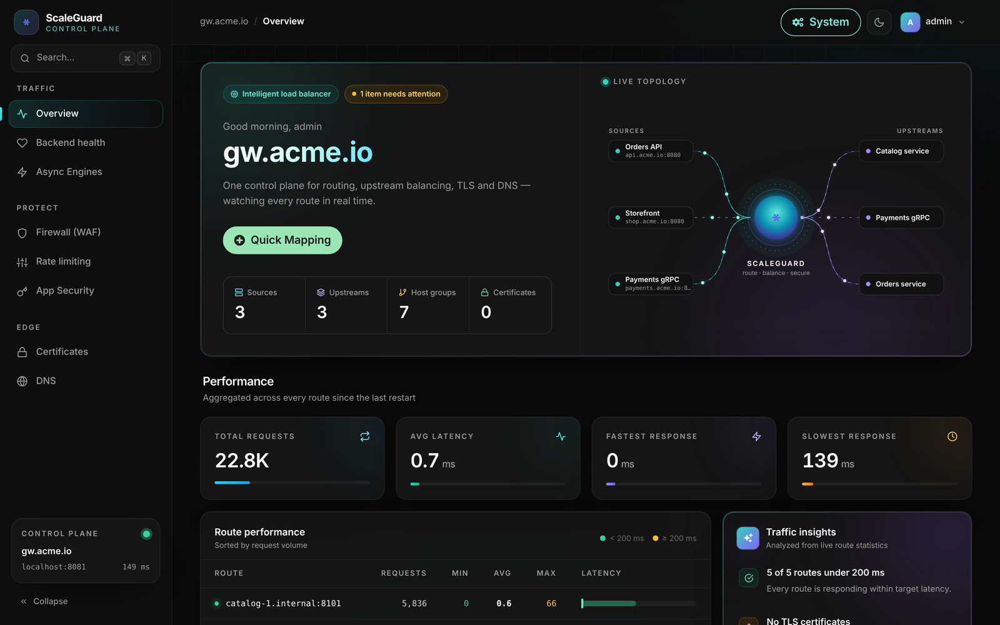
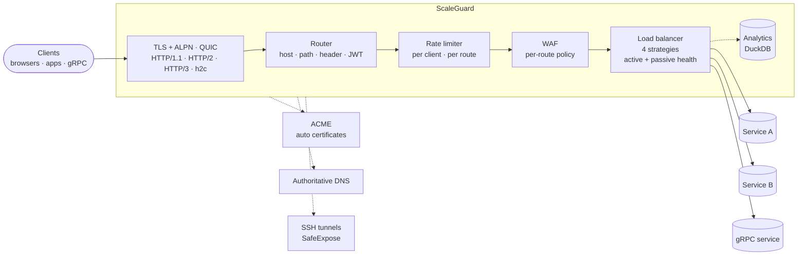
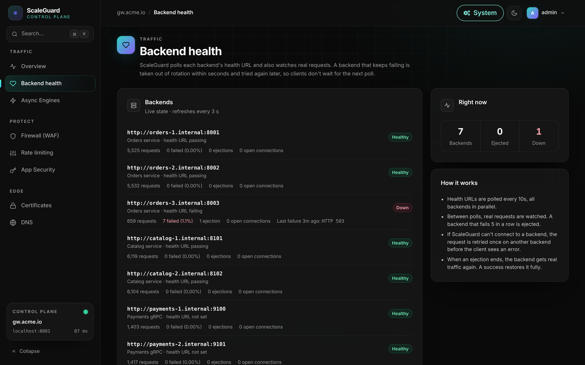
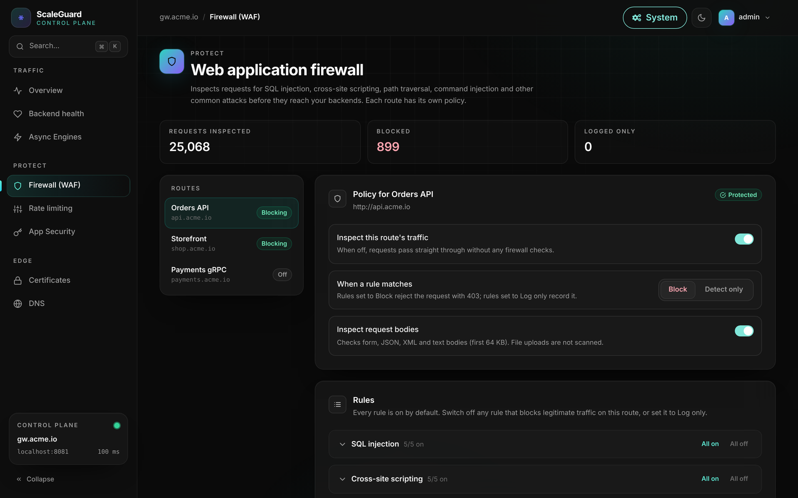
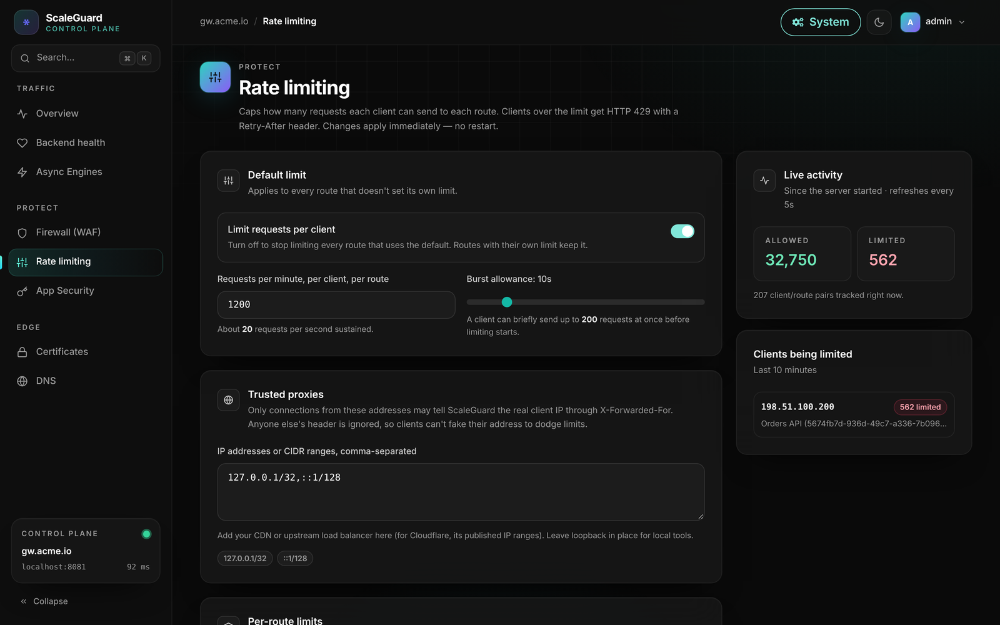
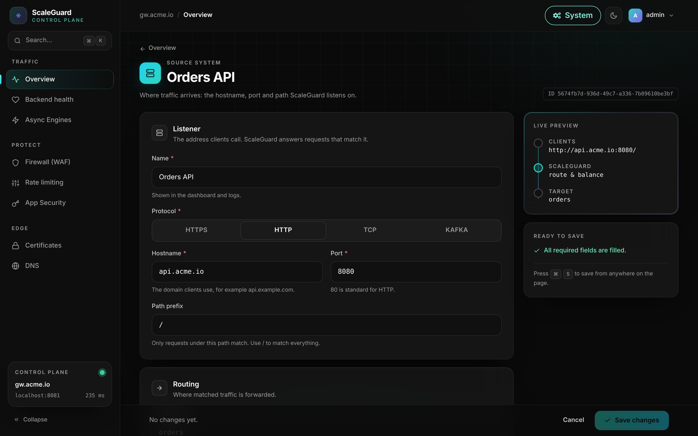

<div align="center">

# ScaleGuard

### The open-source application gateway

**Load balancer · Reverse proxy · WAF · Rate limiting · Auto-TLS · HTTP/2, HTTP/3 & gRPC · Analytics · Clustering · DNS · Tunnels**\
One process replaces the five or six tools you put in front of your services today.

[](https://github.com/dhaneeshtb/scaleguard/actions)
[](https://opensource.org/licenses/MIT)
[](https://openjdk.org/)
[](https://netty.io/)
[](docs/openapi.yaml)
[](http://makeapullrequest.com)
[](https://github.com/dhaneeshtb/scaleguard)

[**Quick start**](#-quick-start) · [**Features**](#-what-you-get) · [**Performance**](#-performance) · [**Comparison**](#-how-it-compares) · [**API docs**](docs/API.md) · [**Roadmap**](#%EF%B8%8F-roadmap)

</div>

<p align="center">
  <picture>
    <source media="(prefers-color-scheme: light)" srcset="docs/images/overview-light.png">
    
  </picture>
</p>

---

## Why an application gateway?

Putting a service on the internet usually means stitching together a load balancer, a reverse proxy, a certificate
client, a WAF, a rate limiter, a DNS provider and a dashboard, then keeping their configs in sync.

**ScaleGuard is all of that in one process**, configured live from a web UI or a REST API, with no reloads and no
config files. It runs as a single JAR on a laptop, a VM or a container.



---

## ⚡ Quick start

Requires **Java 21+**.

```bash
git clone https://github.com/dhaneeshtb/scaleguard.git && cd scaleguard
mvn clean install -DskipTests

export SCALEGUARD_ADMIN_USER=admin
export SCALEGUARD_ADMIN_PASSWORD='choose-a-strong-password'
java -DadminUser=$SCALEGUARD_ADMIN_USER -DadminPassword=$SCALEGUARD_ADMIN_PASSWORD \
     -jar target/scaleguard-1.0-SNAPSHOT.jar
```

Open **http://localhost/adminui/** and sign in. Add a route, point it at your backends, and you're serving.

<details>
<summary><b>Docker</b></summary>

```bash
docker build -f docker/Dockerfile -t scaleguard .
docker run -p 80:80 -p 443:443 -p 443:443/udp \
  -e SCALEGUARD_ADMIN_USER=admin -e SCALEGUARD_ADMIN_PASSWORD='choose-a-strong-password' \
  scaleguard
```
</details>

<details>
<summary><b>One API call instead of the UI</b></summary>

```bash
TOKEN=$(curl -s -X POST "http://localhost/signin?scaleguard=true" \
  -d "{\"username\":\"$SCALEGUARD_ADMIN_USER\",\"password\":\"$SCALEGUARD_ADMIN_PASSWORD\"}" | jq -r .token)

# app.example.com → two backends, certificate ordered automatically
curl -s -X POST "http://localhost/config/quickmapping?scaleguard=true" -H "Authorization: $TOKEN" \
  -d '{"name":"app","sourceURL":"https://app.example.com","targets":["http://10.0.0.5:3000","http://10.0.0.6:3000"]}'
```
</details>

---

## ✨ What you get

### Traffic
| | |
|---|---|
| **Layer-7 load balancing** | Round-robin, least-connections, weighted and active/standby (multi-cluster disaster recovery), per target |
| **Routing** | By host name, port, path prefix, header value or JWT claim |
| **HTTP/2, HTTP/3 and gRPC** | ALPN `h2` on TLS, h2c on plain HTTP, and HTTP/3 over QUIC on every HTTPS port (advertised with `Alt-Svc`, same certificates, multi-core UDP listeners). Each can be switched per route, like nginx's per-server `http2` / `http3` / `grpc_pass`. gRPC unary, client-, server- and bidirectional streaming proxied message by message, trailers intact, over pooled HTTP/2 backend connections |
| **WebSockets and TCP** | WebSocket upgrade proxying and raw TCP routes |
| **Caching** | Per-route response cache with TTLs |
| **Cloud functions** | Answer a route with a small **Groovy** program instead of a backend: pick a function as a route's target (or in Quick Mapping) and it replies to any URL pattern and HTTP method, with `method`, `path`, `headers`, `query` and the parsed `body` as ready-made variables. Auth, rate limits, WAF, IP rules, CORS, analytics and the response cache (with TTLs) apply like for any target. Runs in a sandbox: no files, processes, reflection, threads or system access, a hard time limit, bounded memory and output, and **outbound network calls off unless you enable them** per function, with an optional host allow-list and SSRF protection (private ranges, redirects, DNS rebinding). Secrets are write-only and exposed per function. Editor, test panel, run logs and examples in the admin UI. [Guide and sandbox limits](docs/CLOUD_FUNCTIONS.md) |
| **Async delivery** | Hand requests to Kafka or an embedded durable queue, with retries and an event audit API |

### Protection
| | |
|---|---|
| **Web application firewall** | 21 built-in rules (SQL injection, XSS, path traversal, command injection, SSRF, Log4Shell, scanners and more) plus your own regex rules, plus **OWASP Core Rule Set import** with CRS-style anomaly scoring and paranoia levels. Enable per route; block, score or detect-only; tune each rule; dry-run any request. Inputs are normalised (multi-pass URL decoding, HTML entities, SQL comments) and patterns are ReDoS-safe |
| **IP blocking & allow-lists** | Block IPs, networks or a whole proxy/CDN edge gateway-wide (permanently or for a set time, one click from the list of rate-limited clients), exempt monitoring and office networks from limits, and give any route its own allow/deny list |
| **Rate limiting** | Token bucket per client per route, smooth across minute boundaries, `429` + `Retry-After`. Per-route overrides; trusted-proxy aware, so spoofed `X-Forwarded-For` can't dodge it. In a cluster, one budget across all nodes (`strict` mode: never exceeded, steady per-client throughput) |
| **OAuth 2.0 for APIs** | Built-in authorization server: client credentials and rotating refresh tokens, RS256 JWT access tokens checked at the edge, per-route required scopes, revocation, introspection, JWKS and discovery. Secrets are stored hashed and downloadable once at creation, with ready-to-run samples. [Guide](docs/OAUTH.md) |
| **Admin API safety** | Token auth, separate admin rate limit so a strict setting can't lock you out |

### Resilience
| | |
|---|---|
| **Active health checks** | Every backend's health URL polled in parallel, every 10 s by default |
| **Passive health checks** | Watches real requests. A backend that fails 5 in a row is ejected within seconds, then probed back with real traffic and exponential back-off. If a whole service is ejected it keeps serving rather than failing everything |
| **Connect retries** | A request whose backend refuses the connection is retried on another backend before the client sees an error |
| **Upstream controls** | Per service: connect and response timeouts (`504` on a silent backend), retry count, backend TLS verification and SNI name. Per server: max connections, failures before ejection, ejection time, backup and drain (down) — the nginx `proxy_*` and `server` parameters, editable in the UI |
| **gRPC-native errors** | When the gateway refuses a call, gRPC clients get a proper status (`UNAVAILABLE`, `RESOURCE_EXHAUSTED`, `PERMISSION_DENIED`, `UNIMPLEMENTED`), not an HTML error page |

### Edge services
| | |
|---|---|
| **Automatic TLS** | Let's Encrypt certificates ordered and renewed for every route (HTTP-01 or DNS-01 challenges), picked per connection by SNI |
| **Authoritative DNS** | Host your zones on the gateway itself: A, AAAA, CNAME, TXT, MX, NS, with EDNS0, TCP fallback, response rate limiting, and caching forwarders for allowed networks |
| **SafeExpose tunnels** | Self-hosted ngrok alternative: publish a service from a laptop or private network over SSH with automatic TLS |

### Operations
| | |
|---|---|
| **Admin UI** | Live traffic, analytics, routes, backend health, firewall, rate limits, cluster, certificates, DNS and cloud functions, all editable |
| **REST API** | Everything in the UI is scriptable. [Reference](docs/API.md) and [OpenAPI 3 spec](docs/openapi.yaml) |
| **Request analytics** | Every request recorded in a built-in DuckDB: live dashboards (traffic, status classes, p50/p95 latency, top routes, paths, clients, blocked attacks), searchable access logs with CSV/NDJSON export, and a read-only SQL console. W3C `traceparent` support and an `X-Trace-Id` on every response. No external log stack |
| **High availability** | Nodes form a cluster with no shared database: they elect a master by majority vote (Raft-style), keep identical configuration through a SHA-256-chained DuckDB ledger (changes go to the master and reach every node in milliseconds; tampered copies are refused), re-elect in about 3–6 s if the master dies, route analytics through the master to every node, and support a **DR standby site** that is promoted with one call. See [docs/CLUSTER.md](docs/CLUSTER.md) |
| **Observability** | Prometheus `/metrics`, `/healthz` (503 when no backend is reachable), per-route `/stats`, firewall and rate-limit event feeds |
| **Zero-reload config** | Every change applies instantly; settings persist to SQLite or Postgres |
| **Fast I/O** | Netty 4.2 with io_uring, epoll or kqueue picked automatically, SO_REUSEPORT multi-acceptor listeners |

---

## 🚀 Performance

Measured with the harnesses in [`dev-tools/`](dev-tools/README.md) on a **2-vCPU** cloud VM, with the gateway, the
backend and the load generator sharing those two cores, so dedicated hardware will do considerably better.

| Workload | Result |
|---|---|
| HTTP/1.1 reverse proxy, 50 concurrent clients | **~12,000 req/s**, p99 ≈ 13 ms |
| io_uring vs epoll transport | **+45%** throughput with io_uring |
| WAF enabled on the route | −20–25% throughput |
| gRPC unary through the gateway (h2c / TLS) | **~7,100 / ~5,800 calls/s** on a single client connection |
| DNS (UDP, authoritative answers) | **80,000–110,000 answers/s** |
| WAF test suite | 44/44 attacks blocked, 37/37 legitimate requests allowed |

Reproduce: `dev-tools/go/load.go`, `dev-tools/go/h2check.go … bench=50:8`, `dev-tools/java/LoadGen.java`.

**Head to head, one CPU core each** (October 2026, same backend and `wrk`, 64 keep-alive connections, access logs
off unless noted). The test machine's speed drifts between sessions, so each proxy is shown as a share of NGINX measured
in alternating runs in the same session, with the absolute numbers from one such round:

| Proxy | Requests/s (12-byte body) | vs NGINX | p99 | Requests/s (16 KB body) | vs NGINX |
|---|---:|---:|---:|---:|---:|
| NGINX 1.29 | 55,856 | 100% | 2.6 ms | 41,196 | 100% |
| HAProxy 3.4 | 54,680 | ~98% | 2.7 ms | 41,258 | ~99% |
| **ScaleGuard** | **52,112** | **~93%** | 8.2 ms | **33,918** | **~83%** |
| ScaleGuard + analytics (every request to DuckDB) | — | ~62% | ~30 ms | — | ~58% |
| Envoy 1.39 | — | ~40% | 10.7 ms | — | ~47% |
| Traefik 3.7 | — | ~22% | 23.6 ms | — | ~30% |
| Caddy 2.11 | — | ~18% | 23.1 ms | — | ~22% |

(Envoy, Traefik and Caddy are from the earlier round of the same benchmark.) ScaleGuard is within a few percent of
NGINX for small responses and more than twice Envoy. Its tail latency (JVM garbage collection) and memory
(~200 MB with a 256 MB heap vs ~15–25 MB for NGINX/HAProxy) are where the C proxies are ahead.

**Multi-core scaling** (ARM64, 2 proxy cores with wrk + backend on 2 more, after a 30 s warm-up): 157k req/s for small
responses and 135k req/s for 16 KB, about 12 µs of CPU per request; one core does 67k and 65k. Each core runs its own
event loop with its own `SO_REUSEPORT` listener, so a 4 vCPU / 4 GB server roughly doubles that again. To measure on
your own hardware, see `dev-tools/bench` (`PROXY_CPUS=0-3`).

**Throughput tuning.** The defaults are already tuned for a typical 4 vCPU / 4 GB server:
- **Threads and memory:** one event-loop thread per core (`SCALEGUARD_IO_THREADS`), and a heap of half the machine's
  memory (`SCALEGUARD_HEAP` to override).
- **JVM and Netty:** Parallel GC, and Netty's leak detection and per-access buffer checks off. Turn them back on with
  `-Dio.netty.leakDetection.level=SIMPLE` / `-Dio.netty.buffer.checkAccessible=true` when debugging.
- **Response streaming:** backend responses go to the client as they arrive instead of being buffered whole.
- **Request analytics:** records are only queued on the request path. A separate thread writes them to DuckDB once a
  second in a compact format (repeated text stored as integer codes, about 2× cheaper to write). Analytics still costs
  roughly a quarter of peak throughput on a saturated proxy. Turn it off (`-Dscaleguard.analytics=false`) on nodes
  that only need maximum throughput. Virtual threads are used for background and blocking work (admin queries,
certificate renewal, DuckDB writes); the proxy path itself runs on non-blocking Netty event loops, which is faster
than any thread-per-request model.

---

## 📊 How it compares

What you get **out of the box**, without extra modules, plugins or paid tiers. Checked October 2026; corrections welcome.

| | ScaleGuard | NGINX (OSS) | HAProxy (Community) | Traefik Proxy | Caddy | AWS ALB |
|---|:---:|:---:|:---:|:---:|:---:|:---:|
| L7 load balancing & reverse proxy | ✅ | ✅ | ✅ | ✅ | ✅ | ✅ |
| HTTP/2 + gRPC proxying | ✅ | ✅ | ✅ | ✅ | ✅ | ✅ |
| HTTP/3 (QUIC) | ✅ | ✅ | ✅ | ✅ | ✅ | ❌ (CloudFront) |
| Automatic TLS certificates | ✅ | ✅ module | ✅ 3.2+ | ✅ | ✅ | ✅ ACM |
| Web application firewall | ✅ built-in, per route | module | ❌ (Enterprise) | plugin | plugin | paid add-on (AWS WAF) |
| OWASP CRS with anomaly scoring | ✅ import in the UI | module (ModSecurity, EOL) | ❌ (Enterprise) | ❌ (Hub) | plugin | managed rules (paid) |
| Request analytics + SQL, built in | ✅ DuckDB | ❌ logs only | ❌ logs only | ❌ | ❌ | CloudWatch / Athena |
| Multi-node config sync + shared rate limits | ✅ built in (no database) | ❌ (NGINX Plus) | partial (peers) | ❌ (Hub) | ❌ | ✅ managed |
| Per-client rate limiting | ✅ | ✅ | ✅ | ✅ | plugin | via AWS WAF |
| Authoritative DNS server | ✅ | ❌ | ❌ | ❌ | ❌ | separate (Route 53) |
| Self-hosted tunnels (ngrok-style) | ✅ | ❌ | ❌ | ❌ | ❌ | ❌ |
| Web UI that edits configuration | ✅ | ❌ | ❌ | read-only dashboard | ❌ | AWS console |
| Live config changes via API, no reload | ✅ | ❌ (NGINX Plus) | partial (Runtime API) | ✅ | ✅ | ✅ |
| Prometheus metrics | ✅ | exporter | ✅ | ✅ | ✅ | CloudWatch |
| Runs anywhere, open source | ✅ MIT | ✅ | ✅ | ✅ | ✅ | ❌ AWS only |

**Where others are ahead today:** NGINX and HAProxy have decades of production hardening and lower per-request
overhead; Envoy and Traefik integrate deeply with Kubernetes service discovery; AWS ALB is fully managed and
scales without you running anything. ScaleGuard's edge is breadth: a complete, UI-driven gateway with security and
edge services built in, in one process you own.

---

## 🧭 Configuration model

```
Source system (route)          Target system                    Host groups (backends)
host + port + path   ───────▶  load-balancing strategy ───────▶ 10.0.0.5:3000  (health URL, weight)
TLS, WAF, rate limit           cache, headers, scheme           10.0.0.6:3000
```

```bash
# Backends
curl -X POST "http://localhost/config/hostgroups?scaleguard=true" -H "Authorization: $TOKEN" \
  -d '{"groupId":"orders-hosts","scheme":"http","host":"10.0.0.11","port":"8080","health":"http://10.0.0.11:8080/health"}'
# Load-balancing policy
curl -X POST "http://localhost/config/targetsystems?scaleguard=true" -H "Authorization: $TOKEN" \
  -d '{"groupId":"orders","scheme":"http","hostGroupId":"orders-hosts","lbStrategy":"LEAST_CONNECTIONS"}'
# Public route with an automatic certificate
curl -X POST "http://localhost/config/sourcesystems?scaleguard=true" -H "Authorization: $TOKEN" \
  -d '{"name":"orders","host":"orders.example.com","port":"443","scheme":"https","target":"orders","autoProcure":true}'
```

| Strategy | `lbStrategy` | Behaviour |
|---|---|---|
| Round robin | `ROUND_ROBIN` | Even spread across healthy backends (default) |
| Least connections | `LEAST_CONNECTIONS` | Backend with the fewest in-flight connections |
| Weighted | `WEIGHTED` | Proportional to each backend's `weight` |
| Active / standby | `ACTIVE_STANDBY` | Primary cluster first; standby takes over only when every active backend is down |

📘 **Full API reference: [docs/API.md](docs/API.md)** · OpenAPI spec: [docs/openapi.yaml](docs/openapi.yaml)

### Public endpoints

| Endpoint | Description |
|---|---|
| `GET /health` | Liveness: `{"status":"healthy"}` |
| `GET /healthz` | Uptime, routes, backend reachability, memory. `503` if no backend is reachable |
| `GET /metrics` | Prometheus exposition format |
| `GET /stats` | Per-route request counts and response times |
| `GET /adminui/` | Admin UI |

---

## 🖥️ Admin UI

Everything is live: open `/adminui/` on your gateway, or point the hosted build at
[scaleguard.vercel.app](https://scaleguard.vercel.app/sign-in) to your server. Light and dark themes included.

<table>
  <tr>
    <td width="50%"><br><b>Backend health</b>: every backend's live state, failure rate and ejections, with passive health-check settings.</td>
    <td width="50%"><br><b>Firewall (WAF)</b>: per-route policies, block or detect-only, and every rule switchable.</td>
  </tr>
  <tr>
    <td width="50%"><br><b>Rate limiting</b>: limits, burst and trusted proxies, with the clients being limited right now.</td>
    <td width="50%"><br><b>Route editor</b>: guided forms with validation and a live preview of where traffic goes.</td>
  </tr>
</table>

<sub>Screenshots from a demo gateway serving three services (REST, storefront and gRPC) under live traffic.</sub>

To work on the UI: `cd admin-ui && npm install && npm start`. `./build.sh` builds it into `adminui/`, served at `/adminui/`.

## 🔌 SafeExpose: self-hosted tunnels

```bash
git clone https://github.com/dhaneeshtb/scalegurad-safeexpose.git
./safeexpose --host your-scaleguard-server.com --port 3000
```

Your local app is live at `https://your-scaleguard-server.com` with a real certificate. No port forwarding, no
firewall changes. [SafeExpose docs →](https://github.com/dhaneeshtb/scalegurad-safeexpose)

---

## 🔒 Security

- Admin credentials come from `SCALEGUARD_ADMIN_USER` / `SCALEGUARD_ADMIN_PASSWORD`; never hard-code them.
- Admin API tokens expire (7 days by default, `scaleguard.tokenTtlHours`).
- `X-Forwarded-For` is only trusted from proxies you list, so client IPs used by the WAF and rate limiter can't be spoofed.
- Report vulnerabilities as described in [SECURITY.md](SECURITY.md).

---

## 🗺️ Roadmap

**Shipped**
- [x] HTTP/HTTPS reverse proxy and 4 load-balancing strategies
- [x] Automatic TLS (Let's Encrypt, HTTP-01 and DNS-01)
- [x] HTTP/2, h2c and gRPC proxying (all streaming modes)
- [x] Per-route web application firewall
- [x] Per-client, per-route rate limiting
- [x] Active and passive health checks, connect retries
- [x] Authoritative DNS server
- [x] SafeExpose SSH tunnels
- [x] Admin UI and OpenAPI-documented admin API
- [x] Prometheus metrics, response caching, Kafka/embedded async delivery
- [x] Netty 4.2 with io_uring
- [x] Request analytics and access logs in built-in DuckDB, queryable from the UI
- [x] OWASP Core Rule Set import and anomaly scoring
- [x] High availability: multi-node clusters with shared config and cluster-wide rate limits
- [x] HTTP/3 (QUIC)

**Next**
- [ ] Bot defences: proof-of-work challenge and CAPTCHA, per route
- [ ] Backend connection pooling for HTTP/2 and HTTP/3 streams
- [ ] Helm chart, canary and A/B routing, OAuth2/OIDC, WebAssembly plugins

Want to help? See [good first issues](https://github.com/dhaneeshtb/scaleguard/labels/good%20first%20issue) or
[propose a feature](https://github.com/dhaneeshtb/scaleguard/issues/new?template=feature_request.md).

---

## 🤝 Contributing

| Type | How |
|---|---|
| 🐛 Bug reports | [Open an issue](https://github.com/dhaneeshtb/scaleguard/issues/new?template=bug_report.md) with steps to reproduce |
| 💡 Feature ideas | [Suggest one](https://github.com/dhaneeshtb/scaleguard/issues/new?template=feature_request.md) |
| 📖 Docs | Fix, clarify, add examples |
| 🧪 Tests & code | Pick an issue and open a PR |

```bash
git clone https://github.com/YOUR-USERNAME/scaleguard.git && cd scaleguard
git checkout -b feat/your-feature
mvn clean test
```

Test harnesses for the proxy, WAF, HTTP/2/gRPC and DNS are in [`dev-tools/`](dev-tools/README.md).
See [CONTRIBUTING.md](CONTRIBUTING.md) for guidelines.

---

## 🌟 Star history

If ScaleGuard is useful to you, a ⭐ helps others find it.

[](https://star-history.com/#dhaneeshtb/scaleguard&Date)

## 📜 License

[MIT](LICENSE). Use it freely in personal and commercial projects.

## 💬 Contact

- 📧 dhaneeshtnair@gmail.com
- 🐛 [Issues](https://github.com/dhaneeshtb/scaleguard/issues) · 💡 [Discussions](https://github.com/dhaneeshtb/scaleguard/discussions)

<div align="center">

**One gateway. Every service. Fully yours.**

</div>
